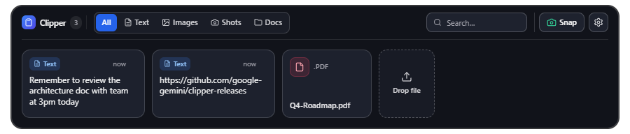

<div align="center">


# Clipper

**A Dynamic-Island-style top-center hover shelf for Windows — clipboard history, quick screenshots, and a drag-and-drop file tray in one hidden dock.**

*Inspired by macOS shelf workflows like Yoink & Dropover, built specifically for Windows 10/11.*


<br />



</div>

---

## Why Clipper?

Most Windows clipboard tools require memorizing another shortcut (`Win + V`) or digging through popup lists, and don't double as a scratchpad for files and screenshots. Clipper stays completely out of your way until you slide your cursor to the **top-center edge of any monitor**, revealing a clean `900px` floating dock with everything you just copied, snapped, or dragged.

| Capability | Clipper | Windows `Win + V` | Traditional Clipboard Managers (Ditto / CopyQ) |
| --- | --- | --- | --- |
| **Zero-shortcut hover trigger** | Yes — slides down from top-center on any display | No (`Win + V` hotkey) | No (hotkey / tray click) |
| **Drag-and-drop pinned file shelf** | Yes — pin docs & files right in the dock | No | Limited |
| **Built-in screenshot capture + folder watcher** | Yes (`Ctrl+Shift+S` / toolbar **Snap**) | Separate (Snipping Tool) | No |
| **Multi-monitor cursor following** | Automatically moves to active display | Active text cursor only | Manual / static window |
| **Secret pattern filtering** | Automatically skips API keys, JWTs, PEM keys, DB credentials | None | Minimal / manual |
| **Storage footprint** | Local SQLite (`clipper.db`), zero cloud sync | Optional Windows cloud sync | Local DB |

---

## Features

- **Top-Center Hover Dock (Multi-Monitor)** — Reveals when hovering within the top-center trigger strip (`16px` height, middle `40%` display width) on any connected monitor and auto-hides `500ms` after leaving.
- **Clipboard History (Text & Images)** — Automatically captures copied text and images and restores any item to your clipboard with a single click.
- **50-Item Soft Cap Prompt** — Prompts inside the dock once clipboard history hits 50 items so you can clear the oldest 25 or clear all without touching pinned files or screenshots.
- **Screenshots (`Ctrl+Shift+S` / Snap)** — Captures desktop screenshots from the global hotkey or the toolbar **Snap** button, generates PNG thumbnails, and watches a user-picked screenshots folder.
- **Drag-and-Drop Pinned Documents** — Drop files onto the dock to pin them with extension-colored cards (`PDF`, `DOCX`, `XLSX`, `MD`, code files, etc.) for one-click opening.
- **Search, Filters & Tray Controls** — Filter by `All`, `Text`, `Images`, `Shots`, or `Docs`, search inline, customize your hotkey/screenshots folder/startup launch in **Settings**, and control everything from the system tray.

---

## Privacy & Security

- **100% Local Data**: Clipboard items, screenshot references, pinned document paths, and settings are stored strictly locally in `%APPDATA%\Clipper\clipper.db` (SQLite). Clipper makes zero network requests and has no telemetry or cloud sync.
- **Automatic Secret Filtering**: Clipboard polling runs content pattern checks before writing to SQLite and silently ignores:
  - JWT tokens (`ey...`)
  - API keys and bearer tokens (`sk-`, `pk-`, `api_`, `Bearer `, `token_`, `secret_`, AWS `AKIA...`)
  - PEM private keys (`-----BEGIN ... PRIVATE KEY`)
  - Database/queue URIs containing embedded credentials (`postgres://user:pass@`, `mongodb://`, `mysql://`, `redis://`, `amqp://`)
  - `Password:` lines copied from password tools

---

## Getting Started

### Prerequisites

- **Windows 10 or Windows 11**
- **Node.js** 20+
- **pnpm**

### Install & Run in Development

```powershell
pnpm install
pnpm dev
```

### Build & Package Windows Installer

```powershell
pnpm build
pnpm dist
```

Packaged outputs are generated in `dist/` (`Clipper Setup 0.1.0.exe` and `dist/win-unpacked/Clipper.exe`).

---

## Available Scripts

| Script | Description |
| --- | --- |
| `pnpm dev` | Start Electron + Vite in development mode |
| `pnpm build` | Build main, preload, and renderer bundles (`out/`) |
| `pnpm dist` | Build production bundles and package Windows NSIS installer (`dist/`) |
| `pnpm test` | Run Vitest unit and component tests |
| `pnpm test:watch` | Run Vitest in watch mode |
| `pnpm test:e2e` | Run Playwright Electron end-to-end tests |
| `pnpm lint` | Run ESLint across TypeScript/TSX files |

---

## Project Structure

```text
clipper/
├── .github/ISSUE_TEMPLATE/ # Bug report and feature request templates
├── docs/                   # Preview screenshots & social banner
├── e2e/                    # Playwright Electron end-to-end tests
├── electron/               # Main process, preload, SQLite store, pollers & trigger zone
│   └── __tests__/          # Main-process unit tests
├── resources/              # App icons (.ico / .png)
├── scripts/                # Test runner helpers
└── src/                    # React dock UI, Zustand store & settings window
    ├── components/         # Dock, Toolbar, Cards, HistoryFullModal, SettingsWindow
    └── __tests__/          # Renderer component & store tests
```

---

## Contributing

Contributions are welcome! See [CONTRIBUTING.md](CONTRIBUTING.md) for local setup, type-checking, linting, and test instructions, or open a bug report / feature request using the issue templates.

## License

[MIT](LICENSE)
